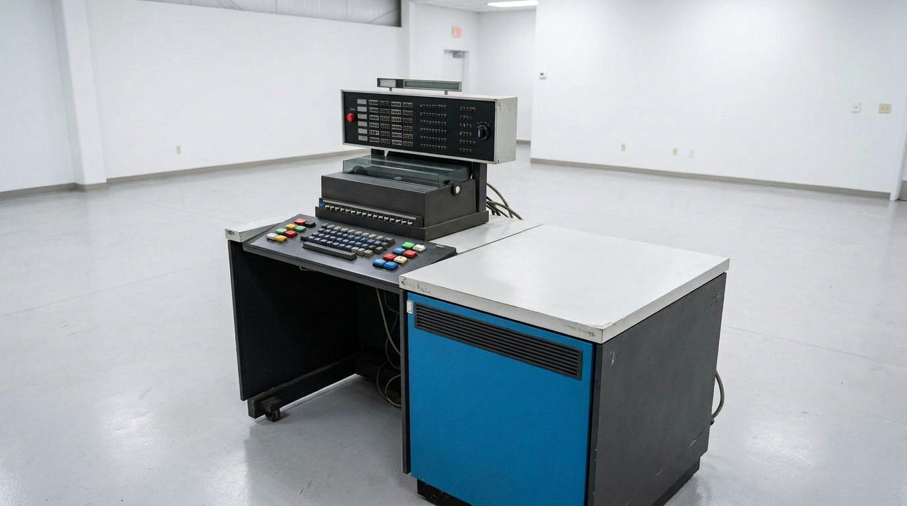
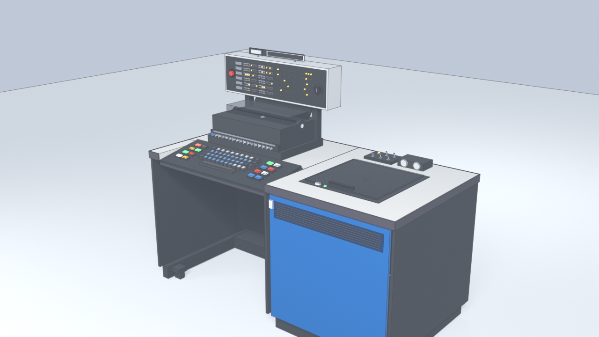

# IBM 1130 Computing System -- 3D Models in X_eTaL & Blender




*Reference hardware: An IBM 1131 Central Processing Unit and console desk.*

---

## Introduction

This project creates accurate 3D models and renders of the classic **IBM 1130 Computing System** (specifically the **IBM 1131 Central Processing Unit** desk console) using **X_eTaL** code driving **Blender** via `../X_eTaL` and `../X_eTaL-extensions` (`Blender.xtl` and `Bpy.xtl`).

The goals of this project are two-fold:
1. **Interactive UI & Simulation**: To produce high-quality, physically proportioned 3D assets (`.glb`, `.blend`, `.obj`) with individually named semantic parts (switches, buttons, indicator lights, platen, disk bay) suitable for interactive web/WebGL simulators, educational tools, and retrocomputing projects.
2. **Dogfooding X_eTaL**: To stress-test and showcase the capabilities of the X_eTaL array programming language and its Blender batch-automation extension pipeline on a non-trivial, multi-part hardware assembly.

---

## Overview

The 3D model is constructed from scanned IBM service manual diagrams (`1130-diagrams/`) and preserved hardware photographs (including the Computer History Museum, VCF, and University archives).



*The rendered 3D model generated directly by X_eTaL driving Blender 5.1.*

### Physical Proportions & Scale
- **Width**: 58.5 inches (1.486 m)
- **Depth**: 29.0 inches (0.737 m)
- **Desk Height**: 29.1 inches (0.740 m)
- **Total Height**: 44.1 inches (1.121 m) to the top of the elevated display panel

### Semantic Component Hierarchy (440 Parts, 11,964 Triangles)
Every component is grouped and named for easy programmatic access:

- **Desk & Cabinet Frame**:
  - Right pedestal housing electronics with the signature vibrant **IBM Royal Blue** front service door (`#0a338a`) and a 7-slot horizontal ventilation grille.
  - Tabletop in warm formica **cream laminate** with dark edge banding and an open cutout for the slanted keyboard well.
  - Left operator **knee-hole cavity** with recessed modesty panel and 4 industrial swivel caster wheels.
- **Slanted Console Keyboard Well** (~11° operator incline):
  - **Status Indicator Panel** (left): 8 illuminated indicator jewels (`ALARM`, `SPARE`, `DISK UNLOCK`, `DISK READY`, `RUN`, `PARITY CHECK`, `K.B. SELECT`, `FORMS CHECK`).
  - **Data Input Keyboard** (center): 44 sculpted typewriter keycaps + space bar arranged in authentic IBM 029 / Selectric key layout with IBM slate blue alphas, light gray digits, and dark charcoal function keys.
  - **Control Switch Panel** (right): 8 backlit rectangular pushbuttons (`POWER`, `CONSOLE KEYBOARD`, `PROGRAM START`, `IMM STOP`, `PROGRAM STOP`, `RESET`, `LOAD IAR`, `PROGRAM LOAD`).
- **Console Printer** (IBM Selectric / 1053 base):
  - Rubber platen cylinder, left/right platen twirler knobs, carriage guide rails, typeball carrier mechanism, and smoked transparent acrylic paper deflector / dust hood.
  - **16 Console Data Bit Switches** (bits 0 to 15) with individual chrome bat toggle levers along the front apron.
- **Elevated Console Display Panel**:
  - Mounted above the printer on twin steel riser posts.
  - **IBM 1130 Computing System** nameplate badge mounted on chrome standoffs.
  - Emergency Power Off (**EPO**) circular bezel with bright red pull switch on the left.
  - Fluted **Rotary Mode Switch** on the right with 7 indexed positions (`Int Run`, `Run`, `SI`, `Disp`, `Load`, `SS`, `SMC`).
  - **6 Register Rows** with alternating light and dark gray 4-bit nibble background bands and warm glowing incandescent amber indicator lamps (`IAR`, `SAR`, `SBR`, `AFR`, `ACC`, `EXT`).
  - Center and right timing lights (`T0`–`T7`), cycle controls, operation register, interrupt levels, and cycle counters.
- **IBM 2315 Single Disk Storage Bay**:
  - Recessed top-loading drive bay on the right desktop with central magnetic spindle hub and alignment rails.
  - Smoked transparent acrylic hinged door with chrome pull handle.
  - Front drive on/off switch and ready lamp.
  - Rear ledge **CE Switch Panel** (6 switches: `Lamp Test`, `Parity Run`, `Storage Load`, `Interrupt Delay`, `No-Stor Load Cycle`, `Display Storage`) and dual circular **Customer Use** & **CE Elapsed Time Meters**.

---

## Source Files (X_eTaL)

- [`Ibm1130Colors.xtl`](file:///Users/mike/github/softwarewrighter/s1130-3D/Ibm1130Colors.xtl) -- Color palette and PBR material definitions.
- [`Ibm1130Desk.xtl`](file:///Users/mike/github/softwarewrighter/s1130-3D/Ibm1130Desk.xtl) -- Desk enclosure, pedestal, blue door with louvers, knee-hole, tabletop, and casters.
- [`Ibm1130Keyboard.xtl`](file:///Users/mike/github/softwarewrighter/s1130-3D/Ibm1130Keyboard.xtl) -- Slanted keyboard well with status lamps, typewriter keys, and control switches.
- [`Ibm1130Printer.xtl`](file:///Users/mike/github/softwarewrighter/s1130-3D/Ibm1130Printer.xtl) -- Selectric printer with platen, knobs, typeball carriage, cover, and 16 bit toggle switches.
- [`Ibm1130DisplayPanel.xtl`](file:///Users/mike/github/softwarewrighter/s1130-3D/Ibm1130DisplayPanel.xtl) -- Elevated display console, badge, EPO, rotary switch, register nibble bands, and lamps.
- [`Ibm1130DiskDrive.xtl`](file:///Users/mike/github/softwarewrighter/s1130-3D/Ibm1130DiskDrive.xtl) -- 2315 disk drive bay, spindle, acrylic cover, CE switches, and meters.
- [`Ibm1130.xtl`](file:///Users/mike/github/softwarewrighter/s1130-3D/Ibm1130.xtl) -- Master assembly connecting all 440 semantic parts, studio lighting, PBR materials, and 5 camera rigs.
- [`make-ibm1130.xtl`](file:///Users/mike/github/softwarewrighter/s1130-3D/make-ibm1130.xtl) -- Main executable driver that generates scripts, runs Blender in batch mode, exports assets, renders PNGs, and writes the web viewer.
- [`justfile`](file:///Users/mike/github/softwarewrighter/s1130-3D/justfile) -- Task runner recipes.

---

## Build and Usage Instructions

### Prerequisites
- [Blender](https://www.blender.org/) 5.x installed (`/Applications/Blender.app` on macOS or on `PATH`).
- The `xetal-x` binary built in `../X_eTaL-extensions`.
- [just](https://github.com/casey/just) command runner (optional, but recommended).

### 1. Build Model, Export Formats & Render Stills
Run the driver script with `just`:

```bash
just render
```

Or execute directly with `xetal-x`:

```bash
XETAL_PATH="../X_eTaL-extensions/extensions/blender/lib:." ../X_eTaL-extensions/target/debug/xetal-x --ext ../X_eTaL-extensions/extensions run make-ibm1130.xtl
```

### 2. View in Interactive 3D Web Viewer
Open the generated Google `<model-viewer>` app in your browser:

```bash
just view
```

This serves [`work/ibm1130/out/index.html`](file:///Users/mike/github/softwarewrighter/s1130-3D/work/ibm1130/out/index.html) where you can orbit, pan, zoom, click preset camera angles, and download 3D assets.

### 3. Generated Files (`work/ibm1130/out/`)
- **`ibm1130.glb`**: Binary glTF 2.0 (1.1 MB) containing all 440 named meshes, materials, and hierarchy.
- **`ibm1130.blend`**: Native Blender scene with cameras, materials, and lights.
- **`ibm1130.obj` / `ibm1130.mtl`**: Standard Wavefront OBJ and MTL files.
- **Rendered Multi-Camera PNGs**:
  - `overview.png`: 3/4 perspective system overview.
  - `operator.png`: First-person seated operator cockpit viewpoint.
  - `display.png`: Telephoto close-up of registers, nibble bands, and indicator lights.
  - `keyboard.png`: Close-up of typewriter keybed, status jewels, and pushbuttons.
  - `disk.png`: Close-up of the 2315 disk drive bay and CE switch console.
- **`report.txt`**: Complete mesh and object validation report.

---

## Copyright and License

Copyright (c) 2026 Michael A. Wright

Licensed under the MIT License. See [LICENSE](LICENSE) and [COPYRIGHT](COPYRIGHT) for details.
